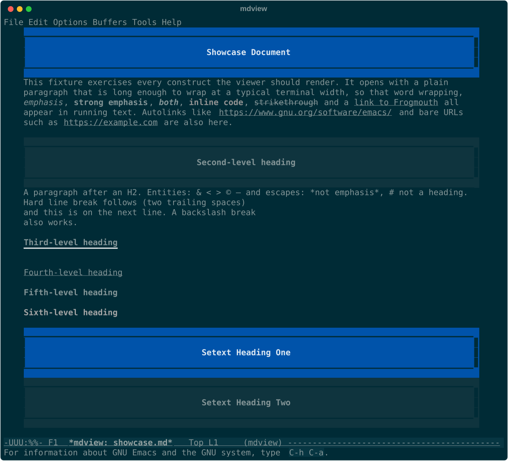
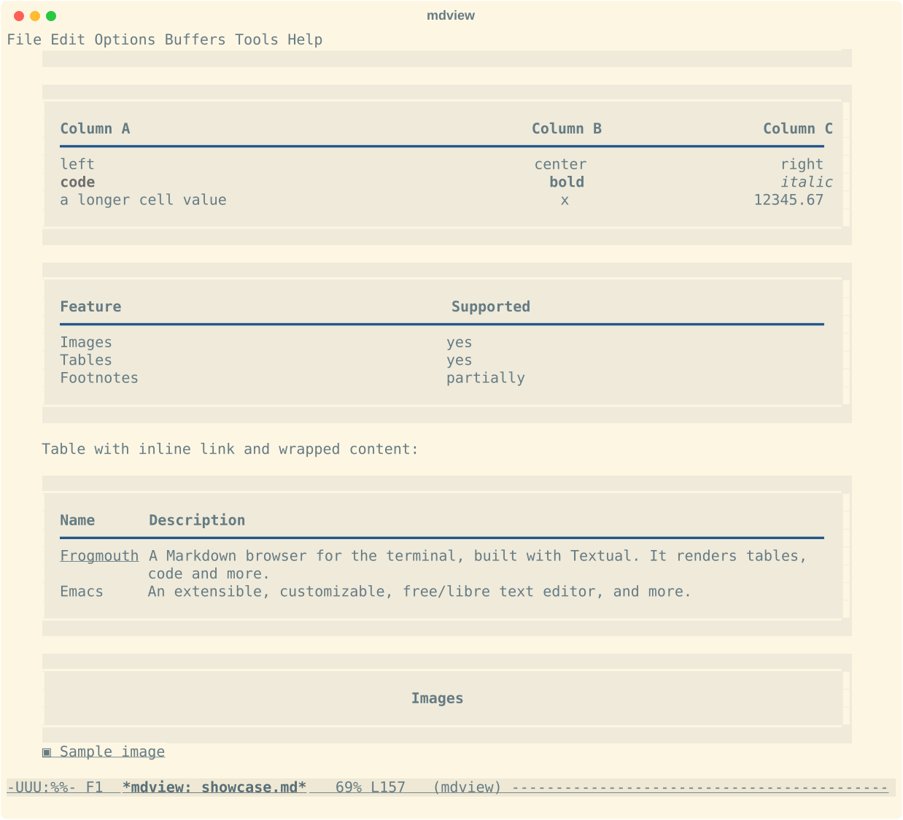
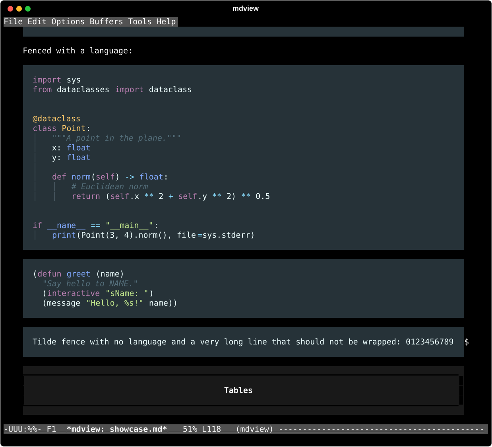
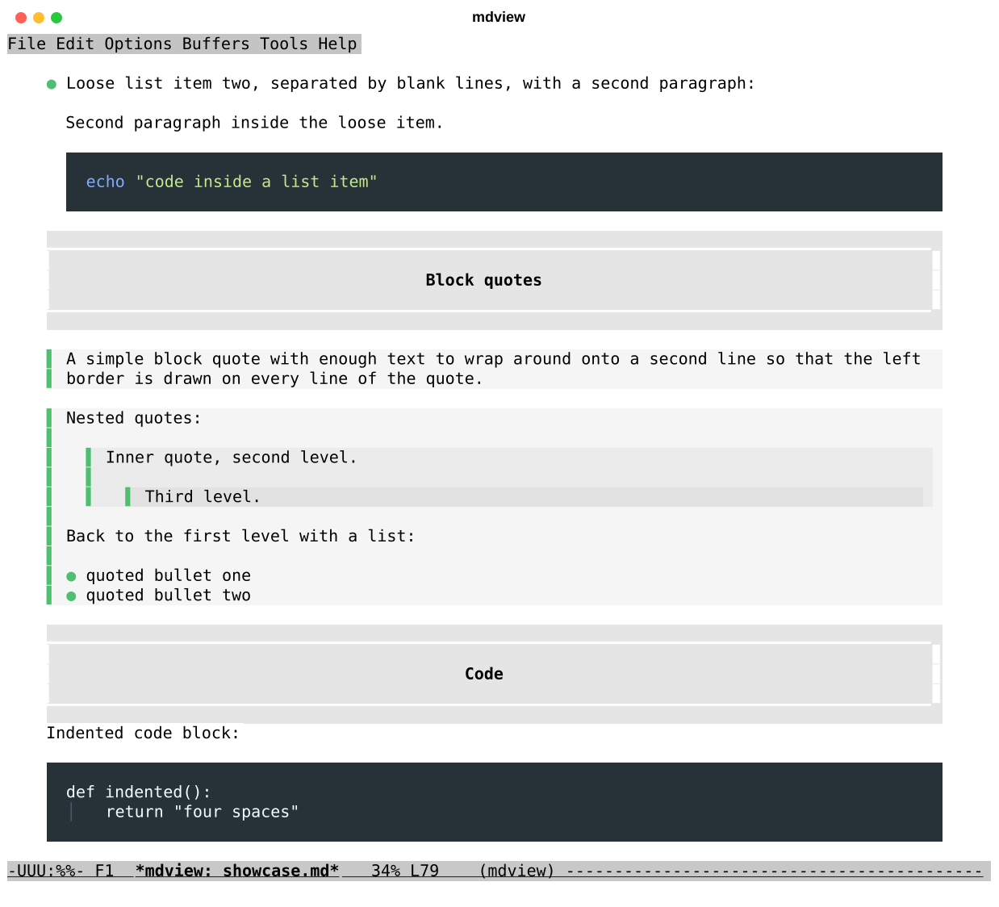

# mdview — a Frogmouth-style Markdown viewer for Emacs

`mdview` renders a Markdown buffer into a read-only, beautifully laid out
view inside Emacs, in the visual style of
[Frogmouth](https://github.com/Textualize/frogmouth), the terminal Markdown
browser by Dave Pearson and Textualize: boxed headings, green bullets,
bordered block quotes, dark syntax-highlighted code panels, and full-width
panel tables.  It works in both graphical and text-mode Emacs; graphical
Emacs additionally shows images inline.

It is a *viewer*, not an editor or a file browser: you keep editing in
`markdown-mode` or `md-mode`, press one key to see the rendered document,
and press it again to go back.  File management, bookmarks, history panes
and the other application features of Frogmouth are deliberately left to
Emacs itself.

## Screenshots

Text-mode Emacs (`emacs -nw`) showing `test/fixtures/showcase.md` in the
Solarized dark and light themes and in Emacs's own `modus-vivendi` and
`modus-operandi`.  The heading and table panels, block quotes and frames
take their colours from whichever theme you use.

<table>
<tr>
<td>

</td>
<td>

</td>
</tr>
<tr>
<td>

</td>
<td>

</td>
</tr>
</table>

## Status

The package is functional and tested but not yet released.  What works
today: a from-scratch CommonMark 0.31 parser with the GFM extensions
(tables, strikethrough, task lists, footnotes, bare-URL autolinks; 647 of
the 652 CommonMark spec examples pass, see `make commonmark`), the full
Frogmouth layout (boxed H1/H2, H3 rule, bullets, ordered and task lists,
nested quotes with bars, code panels with Material highlighting and indent
guides, panel tables with Rich-style column expansion, wrapping and
alignment), footnotes, GitHub alerts (`> [!NOTE]` and friends), the HTML
found in real READMEs (centered blocks, `<details>`/`<summary>`, `<kbd>`,
HTML headings and images), images (inline in graphical Emacs, local and
asynchronous remote, placeholders in text mode), and the `mdview-mode`
commands: toggle with position sync, links and anchors, headings and
imenu, history, image toggling, auto-refit on resize and refresh on save.
The parser and renderer are fuzzed and bounded (nesting caps, linear
time on adversarial input), so odd documents degrade instead of hanging.
The golden renderings in `test/golden/` are compared line by line with
Frogmouth's own output in `test/reference/`.  See
[docs/DESIGN.md](docs/DESIGN.md) for the architecture and the style
specification, and `AGENTS.md` for contributor conventions.

## Goals

- **Beautiful, faithful rendering** of CommonMark + GitHub-flavoured
  Markdown (tables, strikethrough, task lists, autolinks, footnotes) in the
  Frogmouth look, with a palette that adapts to light and dark Emacs themes.
- **Images and tables are first-class.**  Local and remote images are shown
  inline (scaled to the view width) in graphical Emacs, with a placeholder in
  text mode.  Tables get Frogmouth's panel style, with proper column layout,
  cell wrapping, and column alignment.
- **Code blocks** use Emacs's own major modes for syntax highlighting, mapped
  onto the Material palette Frogmouth uses, with indent guides.
- **Zero external dependencies.**  Pure Emacs Lisp (Emacs 29.1+): the parser,
  layout engine and renderer are all in this package.  No pandoc, no
  markdown-it, no browser.
- **Works everywhere Emacs runs**: GUI and `emacs -nw`, any terminal with a
  Unicode font (ASCII fallbacks are configurable).
- **Plays well with your Markdown mode.**  A single command,
  `mdview-toggle`, flips between the source buffer and the rendered view and
  keeps your position.  Bind it in `markdown-mode`, `gfm-mode`, `md-mode` or
  anywhere else.

## Installation

The package is not (yet) on MELPA.  With Emacs 29+ you can install it from
git:

```elisp
(unless (package-installed-p 'mdview)
  (package-vc-install '(mdview :url "https://github.com/vzaliva/emacs-md-render")))

(use-package mdview
  :commands (mdview mdview-file mdview-toggle)
  :bind (:map markdown-mode-map ("C-c C-v" . mdview-toggle)))
```

Name the package explicitly, as above.  Given only the URL,
`package-vc-install` names the package after the repository
(`emacs-md-render`), so a `(package-installed-p 'mdview)` guard is never
true: Emacs then re-runs the install at every start, asks "Overwrite
previous checkout for package `emacs-md-render'?", and if you decline the
error aborts the rest of your init file (themes, fonts and all).  If you
already installed it the URL-only way, either guard on
`'emacs-md-render` instead, or remove that package (`M-x package-delete`)
and reinstall with the snippet above; otherwise both copies get activated.

If you use [md-mode](https://github.com/yibie/md-mode), which already binds
`C-c C-v` to its own in-place renderer, rebind it to `mdview-toggle`:

```elisp
(with-eval-after-load 'md-mode
  (define-key md-mode-map (kbd "C-c C-v") #'mdview-toggle))
```

Or let the package install the binding in all Markdown modes it knows about:

```elisp
(mdview-install-keybinding "C-c C-v")
```

## Usage

| Command | What it does |
|---|---|
| `M-x mdview` | Render the current buffer into a `*mdview: …*` buffer and show it. |
| `M-x mdview-file` | Render a Markdown file. |
| `M-x mdview-toggle` | In a Markdown buffer: show the rendered view.  In a rendered view: return to the source. |

Keys in the rendered view (`mdview-mode`):

| Key | Action |
|---|---|
| `q` | Quit the view (back to the buffer you came from, even after following links to other documents) |
| `g` | Re-render from the (possibly edited) source |
| `TAB` / `S-TAB` | Next / previous link |
| `RET`, `mouse-1`, `mouse-2` | Follow the link at point: anchors scroll to the heading, Markdown files open in the same view (with history), other local files open in Emacs, URLs in the browser; footnote references jump to their definition and back; local images open in Emacs, remote ones in the browser; an image that is itself a link follows the link |
| `n` / `p` | Next / previous heading |
| `t` | Table of contents: pick a heading with completion (the heading at point is the default) |
| `l` / `r` | Back / forward in the view history (when following links between files) |
| `i` | Toggle inline images |
| `e` | Visit the source at the corresponding line |
| `w` | Copy the link at point: local files as the absolute file name they resolve to, URLs as written (`C-u w` always copies the raw link) |
| `SPC` / `DEL` / `S-SPC` | Scroll down / up |
| `<` / `>` | Beginning / end of the document |
| `C-c C-v` | Back to the source (same as `mdview-toggle`) |

The view re-flows automatically when the window width changes
(`mdview-auto-refit`), and re-renders when the source buffer is saved
(`mdview-refresh-on-save`).

## Customisation

`M-x customize-group RET mdview RET`.  The most useful options:

View and layout:

- `mdview-max-width` (default 100): maximum text width in columns; `nil`
  uses the full window.
- `mdview-margin` (default 4): left/right margin, as in Frogmouth;
  `mdview-center-content` (default `nil`) centres the content in wider
  windows.
- `mdview-display-action` (default `pop-to-buffer-same-window`): how the
  view buffer is shown.
- `mdview-auto-refit` / `mdview-refit-delay` (default `t` / 0.2 s): re-flow
  when the window width changes; `mdview-refresh-on-save` (default `t`):
  re-render when the source buffer is saved.
- `mdview-markdown-extensions`: file extensions that links open in `mdview`.
- `mdview-box-frame-style` (`wide` or `none`): the inset frame of the H1/H2
  boxes and tables.
- `mdview-glyphs` / `mdview-ascii-glyphs` / `mdview-use-ascii-glyphs`: the
  bullets (`●`, `▪`, `‣`, `•`, `⭑` like Frogmouth), bars, rules, check
  boxes, the `summary` marker (`▸`) and the alert icons (`alert-note` ..
  `alert-caution`), with an ASCII profile selected automatically (`auto`)
  when the terminal cannot display them; `mdview-image-glyph-fallback`
  (default `▣`) replaces the `🖼` image marker on text terminals and on
  graphical frames whose font does not draw it one column wide.
- `mdview-html-renderer` (`strip` or `shr`): how raw HTML blocks are shown.
- `mdview-table-expand` (default `t`): expand tables to the full width.
- `mdview-panel-blend` (default 0.09): how strongly the level-2 heading
  and table panels stand out from your theme.  The panel is your theme's
  background moved this fraction of the way towards its text colour, so it
  suits any theme, light or dark, instead of Frogmouth's fixed blue-grey;
  the colour is adjusted so that the panel stays visible and the text on
  it readable even for themes with little or much contrast.  Useful values
  run from a few percent to about 0.3; `nil` keeps the fixed colours of the
  `mdview-h2` and `mdview-table` faces.
- `mdview-min-content-width` (default 10): quotes and list items nested so
  deep that fewer columns would remain are rendered flat in their parent
  instead of wrapping a few characters per line.

Images:

- `mdview-display-images`, `mdview-display-remote-images` (default `t`).
- `mdview-image-max-height` (default 0.6 of the frame height, or pixels),
  `mdview-image-max-width` (default `nil`), `mdview-image-timeout`
  (default 10 s per remote fetch), `mdview-image-max-parallel` (default
  6 concurrent fetches), `mdview-image-captions` (default `nil`: show the
  alt text below block images), `mdview-image-placeholder-format` (`nil`
  = `🖼 ALT`).  Remote images are fetched asynchronously; when they
  arrive the view re-flows around them once Emacs is idle, and a fetch
  that fails leaves the placeholder marked "(unavailable)" in its
  tooltip.

Code blocks:

- `mdview-code-lang-modes`: map fenced-code language names to major modes.
- `mdview-code-material-theme`: use Frogmouth's Material code palette
  (`t`), or keep your theme's `font-lock` faces (`nil`);
  `mdview-code-face-alist` is the mapping.
- `mdview-code-indent-guides`, `mdview-code-indent-guide-width` (default
  4), `mdview-code-tab-width` (default 4), `mdview-code-highlight-max-chars`
  (default 100000: larger blocks are shown plain).
- Fontification results are memoized; `M-x mdview-code-clear-cache` forgets
  them (e.g. after changing a major mode's faces), and `mdview-code-debug`
  (default `nil`) reports modes that fail instead of silently showing
  plain text.

Parser:

- `mdview-inline-extended-autolinks` (default `t`): turn bare URLs,
  `www.` domains and e-mail addresses into links (GFM).
- `mdview-parse-front-matter` (default `t`): skip a YAML front-matter
  block; `mdview-parse-max-depth` (default 200): nesting limit for
  container blocks; `mdview-inline-max-depth` (default 100): nesting
  limit for inline markup, beyond which a paragraph is shown as plain
  text.

Faces: everything is a face in the `mdview` group (`mdview-h1`, `mdview-h2`,
`mdview-quote`, `mdview-bullet`, `mdview-link`, `mdview-table`,
`mdview-code-block`, the `mdview-code-*` token faces, `mdview-alert-note`
/ `-tip` / `-important` / `-warning` / `-caution`, `mdview-summary`, …).
The quote backgrounds, the box frames and the level-2 heading and table
panels are derived from your theme's `default` face and follow
`load-theme` / `disable-theme` automatically.  Where Emacs cannot report
the colours (a terminal that does not tell Emacs its background, or one
with fewer than 256 colours) or cannot draw a derived colour faithfully (a
256-colour terminal rounds to its palette), the fixed Frogmouth colours
are used instead; `frame-background-mode` tells Emacs whether such a
terminal is light or dark.

## Development

```sh
make check      # byte-compile with warnings as errors, then run all tests
make test       # ERT tests only
make lint       # checkdoc over the sources (fails on any finding)
make render FILE=test/fixtures/showcase.md WIDTH=100   # dump a rendering as text
                # (WIDTH=98 matches the content width of the Frogmouth reference)
make render-faces FILE=... WIDTH=...        # the same with {face} markers
make golden     # regenerate test/golden/*.txt (review the diff first)
make shot  FILE=test/fixtures/showcase.md   # text-mode Emacs screenshot via tmux
make screenshots # regenerate the README gallery in docs/screenshots/
make commonmark # CommonMark spec conformance report
```

`make shot` and `make screenshots` need tmux, `uv` and `rsvg-convert`
(`librsvg2-bin` on Debian and Ubuntu).  `scripts/tmux-shot.sh` takes
`SHOT_TERM` (for example `xterm-direct` for 24-bit colour) and `SHOT_SETUP`
(a Lisp file loaded before the theme, to put a third-party theme on
`custom-theme-load-path`); the Solarized shots of the gallery need
`SOLARIZED_DIR` set to the directory of the `solarized-theme` package.

To check image display in a graphical Emacs without screenshots, run
`scripts/gui-check.el` in the background with absolute paths (see the
usage comment in the file); it writes a report of every displayed image.

See `AGENTS.md` for the contributor workflow and `docs/DESIGN.md` for the
architecture, the AST contract shared by the parser and renderer, and the
style specification derived from Frogmouth.

## Credits

- The visual design is a port of **Frogmouth** by Dave Pearson
  (davep) and **Textualize**, MIT licensed —
  <https://github.com/Textualize/frogmouth> — and of the
  `Markdown` widget in **Textual** <https://github.com/Textualize/textual>,
  whose default CSS defines the heading boxes, bullets, quote borders and
  table style reproduced here.  Code blocks follow the Pygments "material"
  theme that Frogmouth uses through **Rich**.
- Inspiration for the Emacs side: `markdown-mode` by Jason Blevins,
  `md-mode` by yibie, and Org mode's source-block fontification.
- No code is copied from these projects; `mdview` is a from-scratch
  implementation in Emacs Lisp.

## License

MIT.  See [LICENSE](LICENSE).  Frogmouth and Textual, whose design this
package reproduces, are MIT licensed as well.
