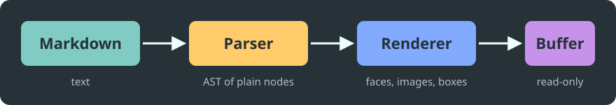

# mdview

A Markdown viewer for Emacs in the style of Frogmouth.  This page is both
the gallery behind the screenshots in the README and a document you can
open with `M-x mdview-file`.

## Typography

Text is wrapped to the window and keeps its **bold**, *italic*, ***both***,
~~strikethrough~~ and `inline code`.  [Links](https://github.com/Textualize/frogmouth)
are underlined and followable, bare URLs such as https://www.gnu.org/software/emacs/
work too, and keys look like <kbd>Ctrl</kbd>+<kbd>X</kbd>.

### A third-level heading

#### And a fourth

Inline images sit in the text line, like this one: .

### Lists

- Bullets change their glyph with the nesting depth
  - the second level
    - the third level
      - the fourth level
- Ordered lists keep their numbers
  1. **Bold** lead-ins read well
  2. and so do *emphasis* and `code`
- [x] Task lists show their state
- [ ] even when nothing is done yet

## Code

Fenced blocks are highlighted with Emacs's own major modes, with indentation
guides and the Material colours, whatever theme is active.

```python
def fibonacci(count):
    """Return the first COUNT Fibonacci numbers."""
    numbers = [0, 1]
    while len(numbers) < count:
        numbers.append(numbers[-1] + numbers[-2])
    return numbers[:count]
```

```elisp
(defun greet (name)
  "Say hello to NAME."
  (interactive "sName: ")
  (message "Hello, %s!" (capitalize name)))
```

```sh
git clone https://github.com/vzaliva/emacs-md-render && cd emacs-md-render
make check
```

## Tables

| Element   | Support  |                    Shown as |
|:----------|:--------:|----------------------------:|
| Headings  | **full** |        boxes and underlines |
| Tables    | *full*   |   as wide as the window     |
| Images    | `png` `svg` | inline in graphical Emacs |
| Footnotes | partial  |      at the end of the page |

Cells wrap to the width of their column and keep their markup:

| Name | Description |
|------|-------------|
| [Frogmouth](https://github.com/Textualize/frogmouth) | A Markdown browser for the terminal, built with Textual.  It renders tables, code, block quotes and more. |
| mdview | A Markdown viewer for Emacs in the style of Frogmouth: **images** and **tables** are first-class, and it follows your theme. |

## Images



Images are scaled to the window; in a terminal they become placeholders.

> Block quotes take their colours from the theme.
>
> > They nest, and hold **markup**, `code` and [links](https://example.com).

> [!TIP]
> GitHub alerts keep their icon and colour: note, tip, important, warning
> and caution.

---

Footnotes[^1] are collected at the end of the page.

[^1]: Like this one, with *markup* in it.
